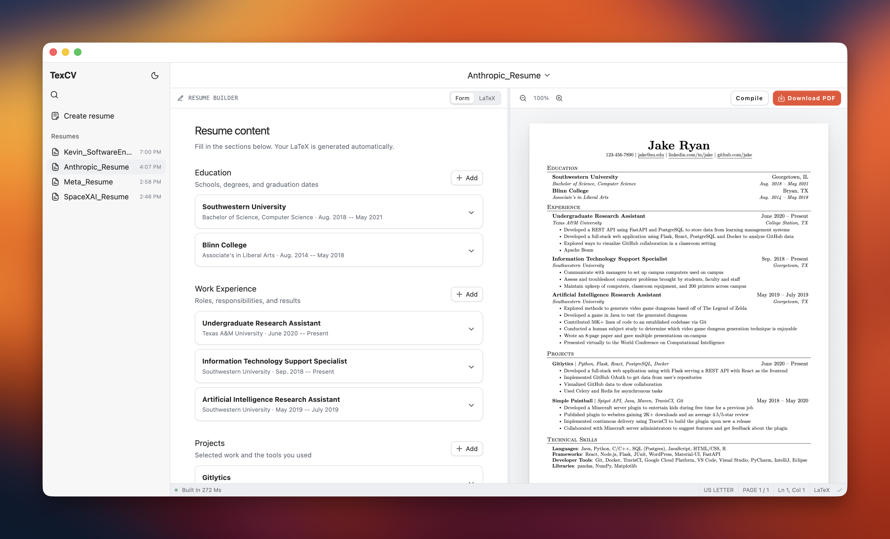

# TexCV

A private, local-only macOS app for editing one-page resumes. It combines a file
explorer, a CodeMirror LaTeX editor, and a live US Letter PDF preview.



## Build it yourself

TexCV requires macOS, Node.js 20 or newer, pnpm, and
[Tectonic](https://tectonic-typesetting.github.io/) for PDF compilation.

1. Install Node.js, pnpm, and Tectonic with [Homebrew](https://brew.sh/):

   ```sh
   brew install node pnpm tectonic
   ```

2. Clone the repository and enter the project directory:

   ```sh
   git clone https://github.com/itsk3vin/tex-editor.git
   cd tex-editor
   ```

3. Install the project dependencies:

   ```sh
   pnpm install
   ```

4. Build and launch the app locally:

   ```sh
   pnpm run desktop
   ```

On first launch, TexCV creates and opens `~/Documents/TexCV`. It reopens the last
workspace after that; if the folder is no longer available, it falls back to the
managed Documents folder. Use File → Open Folder to choose a different workspace.

This project is currently intended to be cloned from GitHub and built locally.
Prebuilt downloads and public distribution are not supported at this time.

## Keyboard shortcuts

- `Cmd-S`: save and compile
- `Cmd-Enter`: compile
- `Cmd-P`: focus the file explorer
- `Cmd-B`: collapse or expand the file explorer

New or unfamiliar LaTeX packages may be downloaded by Tectonic and cached on the
machine. The editor itself has no cloud service, accounts, analytics, or telemetry.
